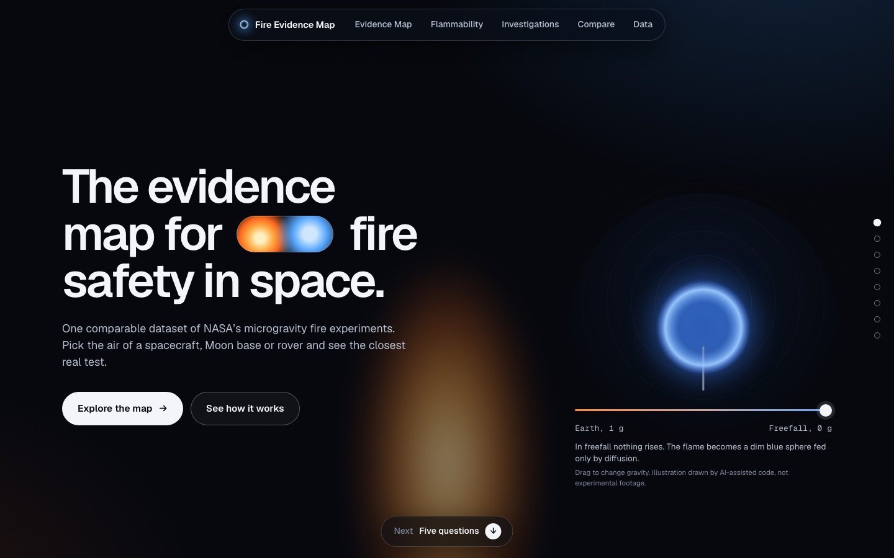
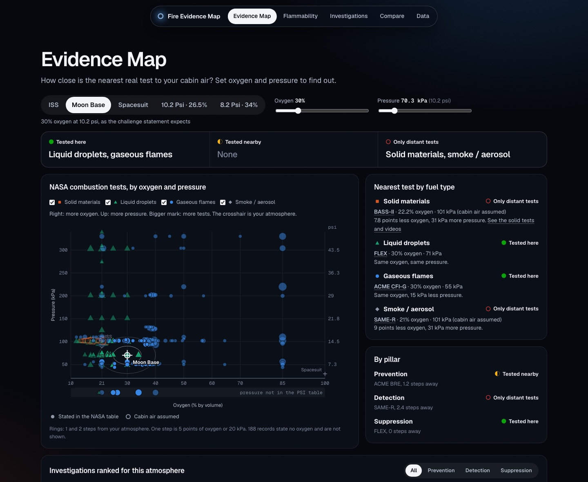
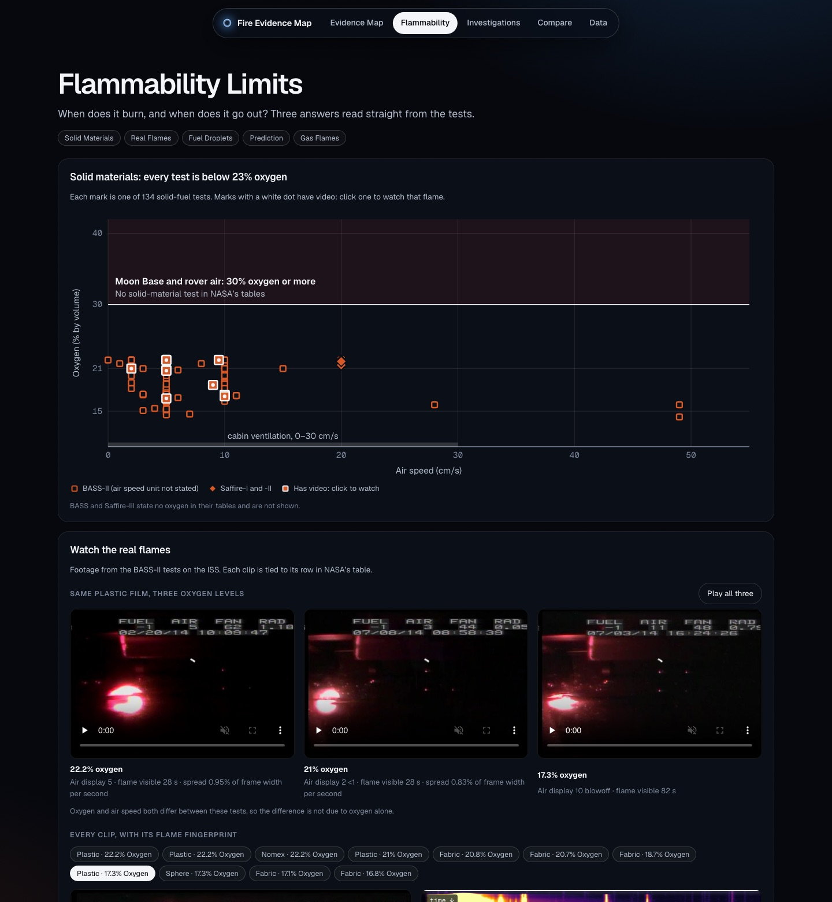
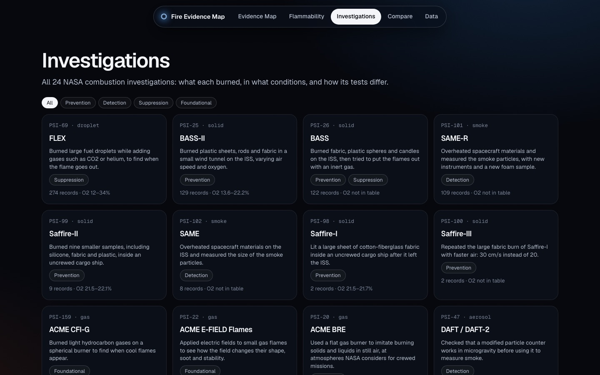

<h1 align="center">Fire Evidence Map</h1>

<p align="center">
  <b>The evidence map for fire safety in space.</b><br>
  What has NASA actually tested about fire in microgravity, and what has it not?
</p>

<p align="center">
  <a href="https://alehcs.github.io/fire-evidence-map/"><b>Open the live site</b></a>
  &nbsp;·&nbsp;
  <a href="#what-we-found">Findings</a>
  &nbsp;·&nbsp;
  <a href="#data-sources">Data</a>
  &nbsp;·&nbsp;
  <a href="#run-it">Run it</a>
  &nbsp;·&nbsp;
  <a href="#use-of-super-intelligence-si">Use of SI</a>
</p>

<p align="center">
  <a href="https://alehcs.github.io/fire-evidence-map/">
    
  </a>
</p>

Built for the 2026 NASA Space Apps Challenge,
[Flame in Freefall](https://www.spaceappschallenge.org/2026/challenges/flame-in-freefall/).

## The problem

NASA publishes its microgravity combustion experiments in the Physical Sciences Informatics (PSI) archive. Each
investigation has its own table, units and level of detail. Oxygen appears as a percentage in one table and as a
mole fraction in the next. Pressure appears in mmHg, atm or bar. The results are hard to find, harder to compare
and harder still to interpret.

## What it does

Fire Evidence Map merges the 24 Combustion Science investigations into one comparable dataset. Then it answers a
practical question:

> For the air of a given spacecraft, Moon base or rover, what has actually been tested, and where would
> fire-safety design be extrapolating?

<table>
  <tr>
    <td width="50%"></td>
    <td width="50%"></td>
  </tr>
  <tr>
    <td><b>Evidence Map.</b> Set oxygen and pressure. See the nearest real test for solids, droplets, gas flames and smoke.</td>
    <td><b>Flammability.</b> Limits read from the tests, with real BASS-II footage from the ISS tied to each data point.</td>
  </tr>
</table>

| View | Question it answers |
|---|---|
| **Evidence Map** | How close is the nearest real test to your cabin air? |
| **Flammability** | When does it burn, and when does it go out? |
| **Investigations** | What did each of the 24 investigations burn, and how did its tests differ? |
| **Compare** | Can two investigations be compared, or did they burn different things? |
| **Data** | Where does every number come from? |

## What we found

| | Finding |
|---|---|
| **1,982** | test records unified from 22 experimental tables, plus day summaries covering 1,044 more flames |
| **22.2%** | the highest oxygen at which any solid material was burned, in the tables that state oxygen. The challenge statement expects 30% or more for the Moon Base |
| **30% at 71 kPa** | FLEX did test fuel droplets in Moon Base air, and ACME CFI-G tested gas flames at 30% and 55 kPa. The gap is in solid materials |
| **35** | anomalies in the source data, reported as found and never silently fixed |

Examples of those anomalies: oxygen written as "3400%", species names produced by spreadsheet auto-increment
("CH5" to "CH14"), a pressure of 0 mmHg, and two sampled test videos that cannot be decoded.

## Data sources

All data comes from **NASA PSI**, released under CC0-1.0:
[psi.nasa.gov/physci/repo](https://psi.nasa.gov/physci/repo/search?q=combustion), Research Area "Combustion
Science".

- **Investigations used (24):** PSI-10, 20, 21, 22, 23, 25, 26, 39, 47, 60, 62, 68, 69, 98, 99, 100, 101, 102,
  106, 107, 115, 117, 142 and 159. Each is cited by its DOI inside the site.
- **Video:** BASS-II (PSI-25) test footage, recompressed.
- **Background:** [A Researcher's Guide to Combustion Science](https://www.nasa.gov/missions/station/a-researchers-guide-to-combustion-science/),
  NASA ISS Program Science Office.

## How it works

| Step | Script | What it does |
|---|---|---|
| 1 | `pipeline/fetch_psi.py` | Downloads the records and experimental tables from PSI |
| 2 | `pipeline/build_dataset.py` | Unifies 22 tables into one schema, keeps every original row, writes the quality report |
| 3 | `pipeline/build_models.py` | FLEX extinction model and CFI-G ignition counts, scored on held-out tests |
| 4 | `pipeline/fetch_videos.py` | Downloads 14 BASS-II test videos |
| 5 | `pipeline/process_videos.py` | Web clips, flame fingerprints and flame-size curves |
| 6 | `pipeline/build_summaries.py` | Plain-language summaries, each quote checked against the PSI record |
| 7 | `web/` | React and TypeScript site built with Vite. Static, no backend |

Three design rules run through all of it:

1. **Nothing is overwritten.** Every record keeps its original row, and every unified value says where it came from.
2. **Fixed rules, no model, for anything that judges evidence.** Unit conversion, distance to evidence, the
   ranking score and the comparability verdict are published on the Data page.
3. **Gaps are shown, not hidden.** Values that are assumed or unverified are drawn differently and labelled.

## Run it

```bash
python3 pipeline/fetch_psi.py
python3 pipeline/build_dataset.py
python3 pipeline/build_models.py
python3 pipeline/build_summaries.py
cd web && npm install && npm run data && npm run dev
```

Python needs `numpy`, `scikit-learn` and `opencv-python`. The optional video steps also need `ffmpeg`.

## Use of super intelligence (SI)

| Where | What SI did | How it is checked |
|---|---|---|
| **Machine learning** | A gradient-boosted tree model predicts the extinction diameter of FLEX fuel droplets | Scored only on test days it never saw: R² 0.78, mean error 0.35 mm. Droplet size alone explains about half |
| **Language model** | Claude (Anthropic) drafted the plain-language summaries of the 24 investigations from PSI text | A script keeps a supporting quote only if it appears word for word in the PSI record |
| **Code** | The pipeline and the site were written with an AI coding assistant (Claude) | Reviewed by the team |
| **Illustrations** | The flames and pillar drawings on the home page are drawn by code | Labelled as illustrations. No NASA imagery or branding is generated or modified |

## Limits

- **Cabin air is assumed.** Tests run in cabin air record no oxygen or pressure. They are placed at 21% and
  101.3 kPa, drawn hollow and never counted as recorded values.
- **One unit is unverified.** The BASS-II "Air display" column has no unit in the table.
- **The model is narrow.** It is fitted to NASA's summary table, not the raw data, and says nothing about solids.
- **Video measurements are relative.** There is no pixel scale, and the camera renders flames in pink.
- **No partial gravity.** PSI holds no partial-gravity combustion data, so nothing here speaks to lunar or
  Martian gravity directly.

---

<p align="center">
  
</p>
